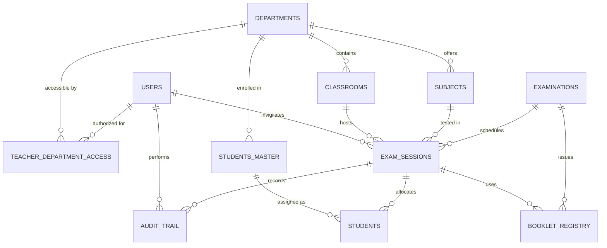

# Barcode-Based Digital Examination Attendance System

A secure, mobile-friendly, full-stack enterprise web application designed for universities and autonomous colleges to digitize the examination attendance recording process.

The system replaces manual physical attendance rosters and answer-booklet signatures with real-time camera-based barcode scanning, centralized database persistence, duplicate detection, atomic validation against an authorized booklet registry, forensic audit trails, and automated Controller of Examinations (COE) Excel reporting.

---

## 🌟 Key Functional Features

| # | Module / Feature | Implementation Details |
|---|---|---|
| **1** | **Role-Based Authentication (RBAC)** | Strict server-side authentication for **Administrator** and **Teacher / Invigilator** roles. Passwords hashed using `werkzeug.security` (Scrypt / PBKDF2). Enforces session expiration, secure cookies, and unauthorized route interception. |
| **2** | **Department & Classroom Dashboards** | Dynamic departmental dashboard (`/departments`) and classroom selection (`/departments/<id>/classrooms`). Teachers only see assigned departments; server denies unauthorized access with HTTP 403. |
| **3** | **Student Roster & Mobile Scanning** | Real-time candidate roster with desk numbers, USNs, and student names. Integrated HTML5 device camera scanner (`html5-qrcode`) supporting Code128, Code39, and QR symbologies. Auto-stops camera after scan. |
| **4** | **Authorized Booklet Registry & Duplicate Prevention** | Validates scanned barcodes against the central `booklet_registry`. Rejects unknown barcodes, void booklets, and barcodes already assigned to another candidate. SQLite transactional optimistic locks prevent concurrent double-assignments. |
| **5** | **Explicit Attendance States & Correction (Redo)** | Explicit states: `PRESENT`, `ABSENT`, and `PENDING`. Correction interface allows invigilators to redo mistakes before submission with mandatory justification reason. Automatically reclaims or reassigns barcodes. |
| **6** | **Pre-Submission Review Screen** | Dedicated review page (`/sessions/<id>/review`) categorizing candidates into **Present**, **Absent**, and prominently highlighted **Pending / Unmarked** lists with direct roster-return controls. |
| **7** | **Submission Finalization & Locking** | Final confirmation modal summarizes assigned, present, absent, and pending counts. Unmarked students trigger warnings. Final submission changes session status to `LOCKED`, preventing ordinary edits. |
| **8** | **Official COE Excel Report (.xlsx)** | Generates publication-grade `.xlsx` spreadsheets via `openpyxl` with 14 standardized institutional columns, metadata summary blocks, signature blocks, sanitized cells (formula injection prevention), and blank barcodes for absentees. |
| **9** | **Digital Audit Trail & Forensic Logging** | Immutable transaction log (`audit_trail`) recording `MARK_PRESENT`, `MARK_ABSENT`, `REDO_CORRECTION`, `LOCK_SUBMISSION`, `UNLOCK_OVERRIDE`, and `BARCODE_REJECTED` with timestamps, invigilator IDs, and client IP addresses. |
| **10** | **Administrator Data Management** | Comprehensive admin console (`/admin`) for managing teacher accounts, academic departments, classroom halls, exam sessions, bulk student CSV imports, and booklet barcode registry imports. |
| **11** | **Emergency Administrative Unlock Override** | Chief Superintendent / COE emergency unlock override requiring authorized credentials (`COE@2026`) and mandatory reason logging in the audit trail. |
| **12** | **Paper Evaluation Cross-Verification** | Dedicated evaluator portal (`/evaluator`) allowing paper evaluation officers to cross-verify physical answer scripts and barcodes against room attendance records to catch discrepancies. |

---

## 🏛️ System Architecture & Technology Stack

- **Backend Framework**: Python 3.9+ / Flask 3.1+ (RESTful JSON APIs & Jinja2 Templates)
- **Database Engine**: Relational SQLite 3 with Write-Ahead Logging (`WAL`), multi-connection concurrency, foreign keys, and unique constraints.
- **Security & Hashing**: `Werkzeug Security` (cryptographic password hashing), HTTP-only session cookies, server-side route & API guard decorators (`@login_required`, `@admin_required`).
- **Reporting Engine**: `openpyxl` for official, styled Controller of Examinations spreadsheet generation with formula injection prevention.
- **Frontend / Mobile UI**: Mobile-first responsive layout, Bootstrap 5.3, FontAwesome 6, SweetAlert2 modals, and `html5-qrcode` camera barcode decoder.

```
hallticket/
├── app.py                      # Flask core, RESTful endpoints, RBAC decorators & routing
├── database.py                 # SQLite relational schema, migrations, connection pool & seed data
├── excel_generator.py          # OpenPyXL official COE attendance report generator
├── run.py                      # One-click launcher with auto-browser launch (0.0.0.0 binding)
├── test_system.py              # Regression test suite (8 test cases)
├── test_comprehensive.py       # Comprehensive verification suite covering all 30 project requirements
├── requirements.txt            # Python dependencies (Flask, openpyxl, Werkzeug)
├── .env.example                # Environment configuration template
├── sample_students.csv         # Sample student bulk import CSV
├── sample_barcodes.csv         # Sample authorized booklet barcode bulk import CSV
├── exam_attendance.db          # Authoritative relational SQLite database
├── generated_reports/          # Output directory for finalized COE .xlsx reports
├── static/
│   └── css/style.css           # Mobile-first portal styles & status badges
└── templates/
    ├── base.html               # Responsive shell, navbar, connectivity monitor, scripts
    ├── login.html              # Institutional login page with show/hide password
    ├── departments.html        # Department selection dashboard
    ├── classrooms.html         # Classroom selection & session cards
    ├── roster.html             # Student roster & mobile camera barcode scanning console
    ├── review.html             # Dedicated final attendance review screen
    ├── submitted.html          # Submission confirmation & download success page
    ├── audit.html              # Public / Invigilator audit log viewer
    ├── evaluator.html          # Paper evaluation cross-verification console
    ├── sample_barcodes.html    # Printable sample 1D/2D barcodes for testing
    └── admin/
        ├── admin_dashboard.html    # Central administrative hub & system counters
        ├── admin_users.html        # Teacher accounts, creation & deactivation
        ├── admin_departments.html  # Department & classroom infrastructure management
        ├── admin_exams.html        # Exam sessions, subjects & invigilator scheduling
        ├── admin_students.html     # Master student directory & CSV bulk import
        ├── admin_barcodes.html     # Authorized booklet registry & CSV bulk import
        ├── admin_audit.html        # Detailed forensic audit trail viewer
        └── admin_reports.html      # Submitted attendance reports & unlock hub
```

---

## 🗄️ Relational Database Schema

The database is fully normalized with foreign key integrity and unique constraints:



1. **`users`**: `(id, username UNIQUE, email UNIQUE, password_hash, full_name, role, department_id, is_active, created_at)`
2. **`departments`**: `(id, code UNIQUE, name, created_at)`
3. **`classrooms`**: `(id, department_id, room_number, building, capacity, created_at, UNIQUE(department_id, room_number))`
4. **`teacher_department_access`**: `(id, user_id, department_id, UNIQUE(user_id, department_id))`
5. **`examinations`**: `(id, exam_code UNIQUE, exam_name, academic_year, term, created_at)`
6. **`subjects`**: `(id, department_id, subject_code UNIQUE, subject_name, qp_code, created_at)`
7. **`exam_sessions`**: `(id, exam_id, subject_id, department_id, classroom_id, course_code, course_name, exam_date, exam_session, room_number, qp_code, invigilator_name, invigilator_id, invigilator_user_id, status, locked_at, locked_by, submitted_at, created_at)`
8. **`students_master`**: `(id, usn UNIQUE, student_name, department_id, semester, email, phone, created_at)`
9. **`students`**: `(id, session_id, student_master_id, usn, student_name, desk_number, attendance_status, qp_barcode, marked_at, marked_by, UNIQUE(session_id, usn))`
10. **`booklet_registry`**: `(id, barcode_value UNIQUE, exam_id, batch_number, status, assigned_session_id, assigned_usn, assigned_at, created_at)`
11. **`audit_trail`**: `(id, session_id, usn, student_name, action_type, old_status, new_status, qp_barcode, reason, invigilator_id, invigilator_name, user_id, timestamp, client_ip)`
12. **`evaluation_verifications`**: `(id, usn, scanned_qp_barcode, session_id, evaluator_name, evaluator_id, verification_status, details, timestamp)`

---

## 🔑 Pre-Configured Demonstration Accounts

| Role | Username | Password | Assigned Scope |
|---|---|---|---|
| **Administrator** | `admin` | `AdminPassword@2026` | Full institutional access (users, departments, exams, CSV imports, audit trail, unlocks) |
| **Teacher (CSE)** | `teacher_ramesh` | `TeacherPass@2026` | Computer Science and Engineering (Room 302, CS801 exam) |
| **Teacher (ISE)** | `teacher_priya` | `TeacherPass@2026` | Information Science and Engineering (Room 405, IS702 exam) |
| **COE Override PIN** | N/A | `COE@2026` or `ADMIN123` | Emergency administrative unlock override code |

---

## 🚀 Getting Started

### 1. Prerequisites
Ensure Python 3.9 or higher is installed:
```bash
python --version
```

### 2. Install Dependencies
```bash
pip install -r requirements.txt
```

### 3. Initialize & Seed Database
```bash
python -c "import database; database.init_db(); database.seed_demo_data(); print('Database ready!')"
```

### 4. Start the Application
Run the launcher script:
```bash
python run.py
```
The server will start at `http://127.0.0.1:5000` (or `http://<your-computer-ip>:5000`) and automatically launch your default browser.

---

## 📱 Mobile Phone Testing Over Local Network (Wi-Fi / LAN)

Because the application binds to `0.0.0.0:5000`, teachers can connect their mobile phones directly:

1. Connect your mobile phone to the same Wi-Fi network as your computer.
2. Find your computer's local IP address:
   - On Windows: Open PowerShell and run `ipconfig` (e.g. `192.168.1.45`).
3. On your phone's browser (Chrome / Safari), navigate to:
   ```
   http://192.168.1.45:5000
   ```
4. Log in as `teacher_ramesh` / `TeacherPass@2026`.
5. Tap **Departments** $\to$ **Computer Science and Engineering** $\to$ **Room 302 (Block B)**.
6. Select any student row and tap **Scan Booklet Barcode**.
7. When prompted, grant camera permission.
8. Point your phone camera at one of the authorized test barcodes on screen or from `/sample_barcodes` (e.g., `BK20260001`, `BK20260002`).
9. Notice the instant validation, sound/visual feedback, and real-time roster update.

> [!NOTE]
> Modern mobile browsers (especially Chrome and Safari) require a **Secure Context** (HTTPS or `localhost`) for full WebRTC camera access. When accessing via a private LAN IP (e.g. `192.168.x.x`), Chrome allows camera testing via `chrome://flags/#unsafely-treat-insecure-origin-as-secure` with `http://<your-ip>:5000`. In production, deploy behind an SSL reverse proxy (such as Nginx with Let's Encrypt).

---

## 🧪 Automated Testing Suite

The repository includes a comprehensive 30-scenario test suite satisfying all criteria in Section 23 of the specifications:

```bash
python test_comprehensive.py
```

### Verified Test Matrix:
- **TEST 1**: Valid teacher logs in successfully (HTTP 302 / session initialized).
- **TEST 2**: Invalid credentials are rejected with meaningful feedback.
- **TEST 3**: Teacher cannot access an unauthorized department (HTTP 403 Forbidden).
- **TEST 4**: Teacher cannot access an unauthorized classroom (HTTP 403 Forbidden).
- **TEST 5**: Correct student roster loads dynamically from the relational database.
- **TEST 6**: Valid registered barcode from `booklet_registry` is accepted.
- **TEST 7**: Unknown / unregistered barcode is rejected (HTTP 400).
- **TEST 8**: Invalid barcode format is rejected.
- **TEST 9**: Barcode already assigned to another student is rejected (HTTP 409 Conflict).
- **TEST 10**: Repeated scans do not create duplicate attendance records.
- **TEST 11**: Failed barcode validation does not mark student present.
- **TEST 12**: Attendance is saved and persisted transactionally in the database.
- **TEST 13**: Attendance persists across browser page refreshes.
- **TEST 14**: Correction (redo) updates the final attendance state correctly.
- **TEST 15**: Audit trail retains original and corrected values with reasons.
- **TEST 16**: Pending / unmarked students are identified before submission.
- **TEST 17**: Unresolved students cannot silently become confirmed absentees.
- **TEST 18**: Invigilator can correct mistakes before final submission.
- **TEST 19**: Submitted session cannot be modified through ordinary endpoints (HTTP 403).
- **TEST 20**: Unauthorized unlocking attempts are rejected (HTTP 403).
- **TEST 21**: Authorized unlocking requires permission and mandatory reason logging.
- **TEST 22**: Excel report contains all 14 required institutional columns and metadata.
- **TEST 23**: Absent students appear correctly in exported Excel report (blank barcodes).
- **TEST 24**: Concurrent attempts to assign the same booklet cannot create conflicting records.
- **TEST 25**: Mobile interface maintains proper responsive viewport and touch targets.
- **TEST 26**: Camera permission denial and hardware errors are handled gracefully.
- **TEST 27**: Camera scanner cleanly stops when requested.
- **TEST 28**: Network/payload errors do not falsely report successful persistence.
- **TEST 29**: CSV bulk import detects duplicate USNs and row-level errors.
- **TEST 30**: Teachers cannot bypass authorization by directly calling admin APIs.

---

## 🔒 Security Assumptions & Honest Limitations

1. **Physical Barcode Duplication**: A physical 1D barcode on paper can be photocopied. Barcode scanning verifies that the booklet identifier is authorized and uniquely assigned in the database, but physical booklet integrity requires authorized watermarked paper and invigilator physical inspection.
2. **Camera Secure Contexts**: Browser security standards restrict WebRTC camera access to `https://` origins or `localhost`. Production deployments must enforce HTTPS.
3. **Database Concurrency**: The SQLite layer employs Write-Ahead Logging (`WAL`) mode with optimistic locking (`WHERE status = 'AVAILABLE'`). For large multi-campus deployments with over 10,000 concurrent students, migration to PostgreSQL is supported through standard SQLAlchemy / relational query abstractions.
